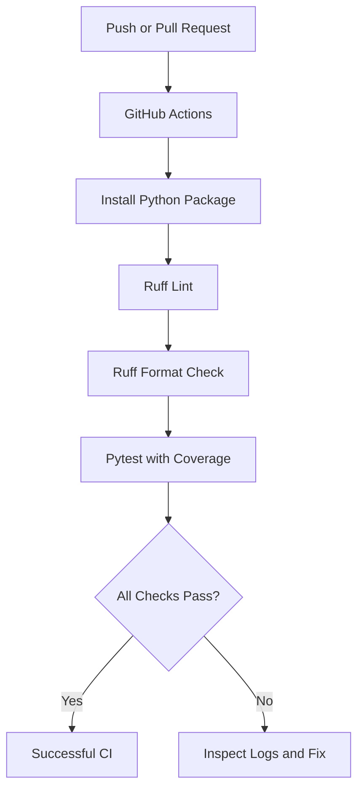

# ShipShape

ShipShape is a small Python quality-gate toolkit designed for developer workflows. It provides a reusable, lightweight pipeline for validating code quality before merge: install dependencies, run linting, verify formatting, and execute tests with coverage enforcement.

## Why this project exists

Teams need a fast, repeatable way to answer one question before merging code: "Is this change ready?" ShipShape focuses on a minimal set of checks that are easy to run locally and in CI so teams can catch obvious issues early.

## Features

- Python package installation via `pip`
- Automated unit tests with Pytest
- Lint checks with Ruff
- Formatting verification with Ruff
- Coverage measurement with `pytest-cov`
- CI enforcement at a 90% minimum coverage threshold
- Simple reusable utilities for text normalization and email extraction

## Technology stack

- Python 3.10+
- Pytest
- pytest-cov
- Ruff
- GitHub Actions
- setuptools

## CI architecture



## Project structure

```text
shipshape-python/
├── src/
│   └── shipshape/
│       ├── __init__.py
│       └── text_utils.py
├── tests/
│   └── test_text_utils.py
├── .github/
│   └── workflows/
│       └── quality.yml
├── .gitignore
├── requirements-dev.txt
├── pyproject.toml
├── README.md
└── .venv/   # local virtual environment, not committed
```

## Prerequisites

- Python 3.10 or newer
- `pip`
- A terminal with access to Python package indexes

## Virtual environment setup

Create and activate a local environment:

```bash
python -m venv .venv
```

Windows PowerShell:

```powershell
.venv\Scripts\Activate.ps1
```

Windows Command Prompt:

```bat
.venv\Scripts\activate.bat
```

macOS/Linux:

```bash
source .venv/bin/activate
```

## Installation

```bash
python -m pip install --upgrade pip
python -m pip install -e .
python -m pip install -r requirements-dev.txt
```

## Running Ruff lint checks

```bash
ruff check .
```

## Running formatting verification

```bash
ruff format --check .
```

## Running tests

```bash
python -m pytest
```

## Running tests with coverage

```bash
python -m pytest \
  --cov=shipshape \
  --cov-report=term-missing \
  --cov-fail-under=90
```

## Coverage threshold

The project enforces a minimum of 90% coverage. This threshold is checked dynamically by `pytest-cov` and is not a hardcoded value in the source code. Coverage measures how much of the code path is exercised by tests, not whether the logic is perfect.

## GitHub Actions workflow behavior

The repository includes a GitHub Actions workflow at `.github/workflows/quality.yml`. It runs on pushes and pull requests, installs the package and development tools, runs Ruff linting, checks formatting, and executes the test suite with coverage. The workflow uses read-only repository permissions and fails whenever a required check fails.

Important: the workflow file is configured correctly for this repository, but GitHub Actions must be verified on GitHub itself before claiming a successful CI run.

## Reusing ShipShape in another project

ShipShape follows a simple package layout and can be reused as a reference for Python quality gates. The main ideas to adapt are:

1. Install the package in editable mode.
2. Keep tests under `tests/`.
3. Use `pytest` with coverage enabled.
4. Run Ruff for linting and formatting checks.
5. Enforce coverage with `--cov-fail-under`.
6. Use GitHub Actions or an equivalent CI runner.

## Diagnosing failures

When checks fail, read the output in order:

1. Lint failures identify style or correctness issues.
2. Formatting failures show code that needs reformatting.
3. Test failures pinpoint broken behavior.
4. Coverage failures show which lines were not exercised by tests.

Fix the first failing issue, rerun the relevant command, and continue until the full check passes.

## Limitations

- The email extractor is intentionally simple and not a full RFC-compliant validator.
- This project focuses on quality gates, not application deployment.
- CI success must be confirmed on GitHub; local runs only confirm the configuration is valid in this environment.

## Future improvements

- Add more package-specific quality checks.
- Expand the utility library with other reusable validation helpers.
- Add badges only after verifying the repository URL and workflow file.
- Add branch protection and required checks in GitHub settings.

## Tests vs linting vs formatting vs coverage vs CI

- Tests verify expected behavior.
- Linting identifies common code-quality issues.
- Formatting checks ensure consistent code layout.
- Coverage measures which code paths were executed.
- CI automates those checks when code changes are pushed or proposed.

## Manual failure demonstration

This is a documented local exercise, not a permanent failing test.

To observe a failing assertion:

1. Temporarily change a valid assertion in `tests/test_text_utils.py` to an incorrect value.
2. Run:

```bash
python -m pytest
```

3. Read the failure output. It will show the expected and actual values.
4. Restore the correct assertion.
5. Rerun:

```bash
python -m pytest
```

6. Confirm that the suite passes again.

If you want to demonstrate a failing GitHub workflow, create a temporary branch, introduce the bad assertion, push it, and then revert it after reviewing the failing CI output. Never leave deliberately broken code on the main branch.

## Reusable command summary

```bash
python -m venv .venv
source .venv/bin/activate  # or .venv\Scripts\Activate.ps1 on Windows
python -m pip install --upgrade pip
python -m pip install -e .
python -m pip install -r requirements-dev.txt
ruff check .
ruff format --check .
python -m pytest --cov=shipshape --cov-report=term-missing --cov-fail-under=90
```
